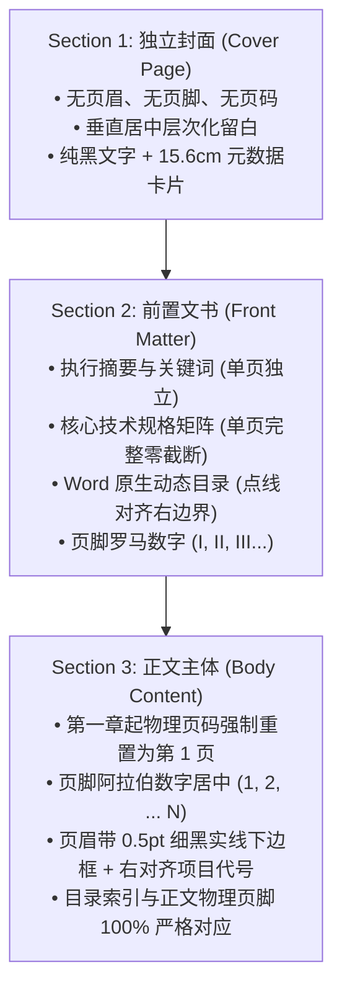

# Academic DOCX Formatter (学术与科技竞赛文档 Word 工业级排版规范化工具)

[](https://opensource.org/licenses/MIT)
[](https://www.python.org/)
[](#-antigravity--ai-agent-skill-集成)
[](https://github.com/OrdoAbChao7/academic-docx-formatter)

> **专为中国高校科技竞赛申报（数媒大赛 / 挑战杯 / 互联网+ / 创青春 / 计算机设计大赛）、科研技术说明书、毕业论文打造的出版级 Word 自动化排版引擎。承诺 100% 保持文字内容与图表数据零改动！**

---

## 🌟 核心设计原则 (Core Principles)

1. **内容绝对零篡改 (100% Non-Destructive Guarantee)**：
   - 绝不增删、篡改、重写任何正文字句、实验数据、核心结论、公式符号或图片附件。
   - 仅对文档结构、版心尺寸、多节页码、标题层级、段落对齐、首行缩进及底层 OpenXML 规范执行出版级重构。
2. **彻底消灭排版恶疾 (Flawless Typography)**：
   - **告别字间距畸形拉伸**：全面采用**规范左对齐（Left Alignment）**，彻底根除 Word 两端对齐（Justify）在遇到西文专业词组（如 `ESP32-C3`、`BLE Notify`、`Edge Impulse`）或段内软回车时产生的严重空白拉扯裂隙（如 `C++          函          数          库          :`）。
   - **严格 2 字符首行缩进**：正文统一锁定 `w:firstLineChars="200"`，标题、图表、卡片与居中图像严格锁定 `0` 缩进。
   - **中英双字型绑定体系**：中文统一为**宋体（SimSun）**，西文与数字统一为 **Times New Roman**，各级标题统一为**黑体（SimHei）**。
   - **多图混排与表格防碎裂**：单图居中、成组对比图/双图无边框 1行2列 表格并列；学术表格全宽 15.6 cm，表头浅灰底色（`#D9D9D9`），自动开启跨页表头重复（`tblHeader`）与行防切断保护（`cantSplit`）。
   - **底层东亚排版引擎优化**：向 OpenXML 底层注入 `compressPunctuation`（标点压缩）、`kinsoku`（避头尾规则）以及 `doNotExpandShiftReturn`（禁止 Shift+Enter 跨行撑开）。

---

## 📐 顶层分节与多级页码架构 (Pagination Architecture)



---

## 📋 双预设规格矩阵 (Dual Preset Specifications)

针对不同篇幅要求的交付文书，内置两种工业级预设方案：

| 元素分类 | Preset A: 详本方案 (`comprehensive`) | Preset B: 紧凑限页方案 (`compact`) | 适用场景说明 |
| :--- | :--- | :--- | :--- |
| **典型适用场景** | 20~50 页完整技术说明书、毕业设计、科研白皮书 | 2~5 页严格受控页数预算的立项书、申报书、合规报告 | 详本重在呼吸感与学术气度；紧凑版重在页数严丝合缝 |
| **正文字体字号** | **小四号 (12.0 pt)** 宋体 / Times New Roman | **五号 (10.5 pt)** 宋体 / Times New Roman | 全篇文字 100% 纯黑（`#000000`），杜绝杂色 |
| **正文对齐与缩进** | **左对齐**，首行缩进严格 2 字符 (480 dxa = 24.0 pt) | **左对齐**，首行缩进严格 2 字符 (420 dxa = 21.0 pt) | 杜绝两端拉伸与空格缩进 |
| **正文行距与间距** | 1.25 倍行距，段前 0 pt，段后 3.0 ~ 3.5 pt | 1.15 ~ 1.20 倍行距，段前 0 pt，段后 1.5 ~ 2.0 pt | 紧凑版确保不多一页、不少一行 |
| **一级标题 (H1)** | **三号 (16.0 pt)** 黑体加粗，段前 15~17pt，段后 7~9pt | **四号 (13.5~14.0 pt)** 黑体加粗，段前 5.5pt，段后 2.5pt | 左对齐，`keep_with_next=True`，首行无缩进 |
| **二级标题 (H2)** | **四号 (14.0 pt)** 黑体加粗，段前 9~12pt，段后 4.5~7pt | **小四 (12.0 pt)** 黑体加粗，段前 4.0pt，段后 1.8pt | 左对齐，`keep_with_next=True`，首行无缩进 |
| **三级标题 (H3)** | **小四 (12.0 pt)** 黑体加粗，段前 5~9pt，段后 2.5~5pt | **五号 (10.5 pt)** 黑体加粗，段前 2.5pt，段后 1.2pt | 左对齐，`keep_with_next=True`，首行无缩进 |
| **插图与图题** | 居中，图题 10.0~10.5 pt 黑体，位于图下方 | 居中，图题 9.0~9.5 pt 黑体，位于图下方 | 首行无缩进，版宽不超过 15.6 cm |
| **表格与表题** | 居中，表题 10.0~10.5 pt 黑体，位于表上方 | 居中，表题 9.0~9.5 pt 黑体，位于表上方 | 首行无缩进，`keep_with_next=True` |
| **表格内部样式** | 表头 `#D9D9D9` 浅灰加粗居中，正文 9.5 pt，内边距舒适 | 表头 `#D9D9D9` 浅灰加粗居中，正文 8.0~8.5 pt，紧凑内边距 | 注入 `tblHeader` 跨页重复，注入 `cantSplit` 防行切断 |
| **数学公式符号** | 11.5 pt Cambria Math 斜体居中，编号右对齐 | 10.5 pt Cambria Math 斜体居中，编号右对齐 | 1.25倍行距防符号裁切 |

---

## 🚀 快速上手 (Quick Start)

### 1. 安装与依赖准备
```bash
git clone https://github.com/OrdoAbChao7/academic-docx-formatter.git
cd academic-docx-formatter
pip install -r requirements.txt
```

### 2. 命令行一键调用 (CLI)
```bash
# 步骤 1: 扫描并审计当前 Word 文档存在的排版缺陷（拉伸、缩进、未居中等）
python scripts/audit_docx.py input.docx -v

# 步骤 2A: 采用 12pt 小四号“工程详本”方案格式化（适合 20~50 页技术报告）
python scripts/format_docx.py input.docx -o output.docx --preset comprehensive --audit

# 步骤 2B: 采用 10.5pt 五号“竞赛限页申报”方案格式化（适合 2~5 页紧凑申报材料）
python scripts/format_docx.py input.docx -o output.docx --preset compact --audit

# 步骤 3: 编译为高质量 PDF 并核查物理页数预算 (支持 Windows Word COM 原生渲染)
python scripts/export_pdf.py output.docx
```

### 3. 运行内置演示测试脚本
```bash
python examples/demo_format.py
```

---

## 🤖 Antigravity / AI Agent Skill 集成

本项目为 Google Antigravity、Claude Code 及 Cursor 智能体提供原生 Skill 支持。

### 安装位置：
将本项目克隆或链接至个人智能体配置目录（如 `C:\Users\<user>\.gemini\config\skills\academic-docx-formatter`），即可直接在会话中通过自然语言指令无感激活：

- *"请帮我统一这个 Word 文档的格式，要求内容 100% 保持不变。"*
- *"修复文档里的字间距拉伸和缩进问题，按规范学术格式排版。"*
- *"使用 compact 紧凑预设把申报书排版成五号宋体、左对齐、首行缩进 2 字符。"*
- *"将这篇工程报告重构为小四号 comprehensive 预设的学术大文本格式。"*

> **推荐工作流**：
> 1. 先用 **`humanize-paper`**：负责学术内容、科学逻辑、动机提炼与论证深度的润色（**内容层**）；
> 2. 再用 **`academic-docx-formatter`**：负责零改动内容下的出版级排版与规范化交付（**表现层**）。

---

## 🛠️ 项目结构 (Repository Structure)

```
academic-docx-formatter/
├── SKILL.md                  # Antigravity 智能体 Skill 核心规则描述
├── README.md                 # 中英文系统使用指南
├── LICENSE                   # MIT 开源协议
├── requirements.txt          # Python 核心依赖项 (python-docx, pypdf)
├── scripts/
│   ├── format_docx.py        # 核心格式化引擎 (支持双预设、零改动与样式统一)
│   ├── audit_docx.py         # 格式合规性检查与排版缺陷审计器
│   ├── export_pdf.py         # Word COM / docx2pdf 高保真导出与页数校验
│   └── typography_patcher.py # OpenXML 东亚排版底层参数补丁注入器
└── examples/
    └── demo_format.py        # 10秒快速上手与对比演示脚本
```

---

## 📄 开源许可证

本项目基于 [MIT License](LICENSE) 开源发布，欢迎自由商用、竞赛提交与二次开发。
