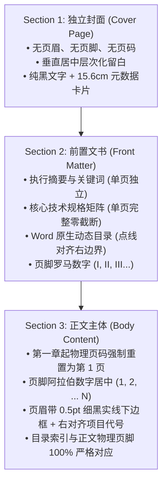

# Academic DOCX Formatter (学术与科技竞赛文档 Word 工业级排版规范化 Skill)

本 Skill 专用于对现有的 Word（`.docx`）文档进行系统性、出版级的工业化排版重构与格式规范化。
**最高铁律：内容零篡改（Zero Content Alteration）**。绝不增删、篡改、重写任何正文字句、实验数据、论证结论、公式符号、图表说明或嵌入式图片，仅在版面几何、分节架构、样式体系、对齐规则、首行缩进及底层 OpenXML 规范上进行系统性标准化。

---

## 适用场景与触发短语

当用户提出以下需求时全面激活本 Skill：
- **格式规范与统一样式**：“统一word格式”、“调整word排版”、“按学术规范排版”、“把格式统一成标准格式”、“将现有申报书规范化”。
- **不改动内容铁律**：“在不改变内容的基础之上”、“只改格式不要改字”、“保留全部原文字句与数据”。
- **排版恶疾修复**：“段落字距拉得太开”、“英文/数字撑得字距很稀疏”、“两端对齐太丑了改左对齐”、“首行缩进混乱”、“图片和图题没有居中”、“表格被生硬切断跨页”。
- **竞赛与答辩材料整改**：数媒竞赛、挑战杯、“互联网+”、毕业设计说明书、白皮书的最终交付排版。

> [!IMPORTANT]
> **与 `humanize-paper` 的职能边界分工**：
> - **`humanize-paper`**：专精于**文本内容与论证逻辑重构**（去 AI 腔、提炼科学动机、强化消融对比、重构叙事链条，属于**内容层**）。
> - **`academic-docx-formatter`**：专精于**版面表现与 Word 排版工业标准**（零改字、统一字体字号、消除拉伸、多节页码、图表表格工业美化与页数预算锁死，属于**表现层**）。

---

## 一、 顶层分节与多级页码架构 (Multi-Section Pagination Architecture)

规范的学术技术报告必须采用清晰的分节流转机制，杜绝“封面带页眉”、“目录页码与正文物理页脱节”等业余排版错误：



---

## 二、 核心排版工业标准全对照 (Typography Specifications)

本 Skill 支持两种工业级基准预设方案（Presets）：
- **Preset A（工程详本 / 学术论文版 · Comprehensive）**：正文小四号（12.0 pt），适合 20~50 页的完整技术说明书与学术大报告。
- **Preset B（竞赛紧凑 / 限页申报版 · Compact）**：正文五号（10.5 pt），适合 2~5 页受控页数预算的竞赛立项书与支撑报告。

### 1. 基础版心与版面几何规范

| 版面元素 | 规范要求 | 底层 OpenXML / Word 属性 | 作用与防错机理 |
| :--- | :--- | :--- | :--- |
| **纸张尺寸** | 标准 A4（210 mm × 297 mm）纵向 | `w:pgSz w:w="11906" w:h="16838"` | 全篇统一，严禁局部横向破裂 |
| **页边距** | 上 `2.54 cm` (72pt)，下 `2.54 cm` (72pt)<br>左 `2.79 cm` (79.2pt)，右 `2.59 cm` (73.5pt) | `w:pgMar w:top="1440" w:bottom="1440" w:left="1584" w:right="1470"` | **有效版心严格锁定 15.6 cm**，杜绝表格/图片超界 |
| **页眉/页脚边距** | 页眉距边界 `1.5 cm`，页脚距边界 `1.5 cm` | `w:pgMar w:header="850" w:footer="850"` | 留足视觉呼吸感，避免与正文重叠 |

### 2. 字体、字级与间距层级矩阵

| 层级对象 | 预设 A (详本小四号 12pt) | 预设 B (紧凑五号 10.5pt) | 字体体系 (中/西) | 段落间距与对齐规范 |
| :--- | :--- | :--- | :--- | :--- |
| **文档主标题** | 18 ~ 20 pt 加粗 | 15 ~ 16 pt 加粗 | 黑体 / Times New Roman | 居中，`firstLine="0"`，段前 6~12pt，段后 3~6pt |
| **一级标题** | **三号 (16.0 pt)** 加粗 | **四号 (13.5~14.0 pt)** 加粗 | 黑体 / Times New Roman | 左对齐，`firstLine="0"`，段前 15~17pt，段后 7~9pt，`keep_with_next=True` |
| **二级标题** | **四号 (14.0 pt)** 加粗 | **小四 (12.0 pt)** 加粗 | 黑体 / Times New Roman | 左对齐，`firstLine="0"`，段前 9~12pt，段后 4.5~7pt，`keep_with_next=True` |
| **三级标题** | **小四 (12.0 pt)** 加粗 | **五号 (10.5 pt)** 加粗 | 黑体 / Times New Roman | 左对齐，`firstLine="0"`，段前 5~9pt，段后 2.5~5pt，`keep_with_next=True` |
| **普通正文段落** | **小四号 (12.0 pt)** | **五号 (10.5 pt)** | **宋体 (SimSun)** / **Times New Roman** | **左对齐（Left Alignment）**，**首行缩进严格 2 字符**（`firstLineChars="200"`），段前 0 pt，段后 2~4 pt，1.20~1.25 倍行距 |
| **图题 (Caption)** | 10.0 ~ 10.5 pt 加粗 | 9.0 ~ 9.5 pt 加粗 | 黑体 / Times New Roman | 位于插图下方，**水平居中**，`firstLine="0"`，段前 2~4pt，段后 4~7pt |
| **表题 (Caption)** | 10.0 ~ 10.5 pt 加粗 | 9.0 ~ 9.5 pt 加粗 | 黑体 / Times New Roman | 位于表格上方，**水平居中**，`firstLine="0"`，段前 3~5pt，段后 2~3pt，`keep_with_next=True` |
| **表格内部文字** | 9.5 pt 宋体 | 8.0 ~ 8.5 pt 宋体 | 宋体 / Times New Roman | 表头加粗居中；数据/指标/单位居中；较长描述左对齐；`firstLine="0"` |
| **数学公式符号** | 11.5 pt Cambria Math | 10.5 pt Cambria Math | Cambria Math | 独立公式水平居中，编号 `(X-Y)` 右对齐，1.25倍行距防符号裁切 |

---

## 三、 排版恶疾根治与工程法则 (Root Cause Solutions)

### 1. 彻底消灭中西文混排字距拉伸（The Text-Stretching Flaw）
- **根因分析**：在 Word 传统的“两端对齐（`w:jc w:val="both"`）”机制下，当行尾出现无法拆分的连续西文字符（如 `ESP32-C3`、`BLE Notify`、`Edge Impulse EON Tuner`）或软换行时，Word 会强行按比例拉扯行内中西文字符间隙，产生极其丑陋的巨大空白裂隙（例如：`C++          函          数          库          :`）。
- **工程解法**：
  1. 正文段落全面切换为 **左对齐（`w:jc w:val="left"`）**；
  2. 底层开启东亚排版标点压缩：`w:characterSpacingControl w:val="compressPunctuation"`；
  3. 启用中西文间距自动微调：`w:autoSpaceDE w:val="1"` 与 `w:autoSpaceDN w:val="1"`。

### 2. 彻底消灭软回车（Shift+Enter / `\n`）跨行撑开
- **根因分析**：许多文档在列表条目（1. 目标... 2. 工具...）间使用 `\n`，Word 将其解析为 `<w:br/>`。在两端对齐下，软回车前的那一行会被强制拉伸满版宽度。
- **工程解法**：
  1. 自动化扫描并将段内 `\n` 拆解为多个独立 `<w:p>` 规范段落；
  2. 在 `word/settings.xml` 中强制注入 `<w:compat><w:doNotExpandShiftReturn/></w:compat>`，彻底锁死软回车撑开通道。

### 3. 多图混排与并列对比图（Side-by-Side Images）
- **单张图像**：水平居中，版宽不超过 15.6 cm，保持原始宽高比，`keep_with_next=True` 紧贴下方图题。
- **成组对比图 / 双图并排**：采用 **1 行 2 列无框无间距隐形表格** 承载，两单元格等宽，各自水平居中，下设对应的分图注或总图注，杜绝文字环绕导致的跑飞移位。

### 4. 工业级学术三线表与全框数据表防碎裂（Anti-Fragmentation Tables）
- 表格全宽对齐有效版心（**15.6 cm**），整体居中；
- 表头行注入浅灰底纹（`#D9D9D9` 或 `#F2F2F2`），注入 `<w:tblHeader/>`，**确保跨页时每一页自动重复表头**；
- 表格所有数据行强制注入 `<w:cantSplit/>`，**彻底杜绝单行文字被生硬横切在两页纸上**；
- 单元格舒适内边距：上下 35~80 dxa（约 2~4 pt），左右 55~140 dxa（约 3~7 pt）。

---

## 四、 自动化脚本工具套件 (Tool Suite)

本 Skill 在 `scripts/` 目录下提供工业级全套 Python 自动化工具：

### 1. 格式合规性深度审计器 (`audit_docx.py`)
扫描待测文档中潜在的排版违规项：
```bash
python scripts/audit_docx.py input.docx -v
```
输出量化报告：
- 两端对齐导致的字距拉伸段落统计
- 段内软换行（`<w:br/>`）残留统计
- 缺失 2 字符缩进的正文段落统计
- 未居中的图片与图表题注统计
- 字体与字号不一致的段落统计

### 2. 核心无损格式化引擎 (`format_docx.py`)
对现有 Word 文档执行一键出版级工业格式化，承诺内容零改动：
```bash
# 使用预设 A (工程详本小四号 12pt)
python scripts/format_docx.py input.docx -o output.docx --preset comprehensive --audit

# 使用预设 B (紧凑申报五号 10.5pt)
python scripts/format_docx.py input.docx -o output.docx --preset compact --audit
```

### 3. 高保真 PDF 导出与页数预算校验器 (`export_pdf.py`)
调用 Windows 原生 Word COM 接口（自动回退 docx2pdf / LibreOffice）编译输出 PDF 并核查物理页数预算：
```bash
python scripts/export_pdf.py output.docx
```

---

## 五、 Python API 代码级调用

```python
from scripts.format_docx import format_document
from scripts.audit_docx import audit_docx
from scripts.export_pdf import convert_to_pdf, verify_page_count

# 1. 一键标准化排版
out_path = format_document(
    input_path="原始文档.docx",
    output_path="格式规范终版.docx",
    preset="compact",          # "compact" (10.5pt) 或 "comprehensive" (12pt)
    align_body="left",          # 强制左对齐，杜绝拉伸
    table_header_bg="D9D9D9",   # 表头浅灰底纹
    split_soft_breaks=True      # 自动拆解软换行为独立规范段落
)

# 2. 审计合规性
is_compliant = audit_docx(out_path, verbose=True)

# 3. 编译 PDF 并校验页数
pdf_path = convert_to_pdf(out_path)
page_count = verify_page_count(pdf_path)
print(f"交付成功！实际编译页数: {page_count} 页")
```
